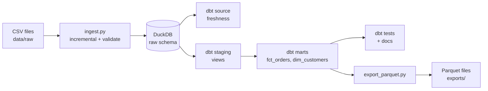
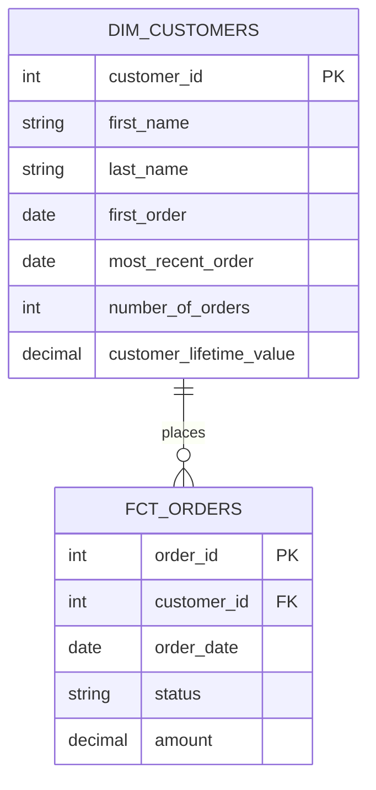

# Jaffle Pipeline: dbt + DuckDB ELT Project

A data engineering project that runs entirely on a laptop at **zero cost**.

A Python script loads raw e-commerce CSV files into **DuckDB** incrementally, validating them on the way in. **dbt** then transforms the raw data into clean, tested, documented analytics tables and monitors how fresh the source data is. The final mart tables are also exported as **Parquet** files.

---

## Table of contents

1. [Project overview](#project-overview)
2. [Architecture](#architecture)
3. [Tech stack](#tech-stack)
4. [Data](#data)
5. [Project structure](#project-structure)
6. [Data model](#data-model)
7. [Getting started (Windows)](#getting-started-windows)
8. [Running the pipeline](#running-the-pipeline)
9. [Data quality and testing](#data-quality-and-testing)
10. [Incremental ingestion](#incremental-ingestion)
11. [Source freshness monitoring](#source-freshness-monitoring)
12. [Parquet export](#parquet-export)
13. [Viewing the documentation](#viewing-the-documentation)
14. [Example queries](#example-queries)
15. [Design decisions](#design-decisions)
16. [Troubleshooting](#troubleshooting)
17. [Acknowledgements](#acknowledgements)

---

## Project overview

**Goal:** build a small but realistic ELT (Extract, Load, Transform) pipeline that demonstrates core data engineering practices:

- Ingesting raw files into a database
- Validating data at the point of ingestion
- Loading data **incrementally** so unchanged files and rows are never reprocessed
- Layering data (raw, staging, marts)
- Modeling data as a star schema (fact and dimension tables)
- Testing and documenting transformations
- Monitoring **source freshness** so stale data is caught early
- Exporting the final tables to **Parquet**, a columnar file format
- Making the whole pipeline reproducible with a single command

**Business scenario:** *Jaffle Shop* is a fictional e-commerce store. The marts can answer questions such as:

- How much has each customer spent in total?
- When did each customer first and most recently order?
- What is the revenue and status breakdown of orders?

---

## Architecture



| Layer | Location | Purpose | Materialization |
|---|---|---|---|
| **Raw** | DuckDB `raw` schema | Data as received, plus a UTC load timestamp and an ingest log | Table (loaded incrementally by Python) |
| **Staging** | `models/staging` | Rename columns, fix units, no joins | View |
| **Marts** | `models/marts` | Business-ready fact and dimension tables | Table |
| **Exports** | `exports/` | Mart tables written as Parquet files | Files |

Keeping the layers separate means transformations never modify the raw data, and each layer has one job.

---

## Tech stack

| Tool | Role |
|---|---|
| **Python 3.10+** | Incremental ingestion, validation, and Parquet export |
| **DuckDB** | Embedded analytics database (a single file, no server needed) |
| **dbt (dbt-duckdb)** | SQL transformations, tests, freshness checks, and documentation |
| **Parquet** | Columnar output format for the mart tables |
| **SQL** | Transformation logic |
| **Git / GitHub** | Version control |

Commands in this README are written for Windows PowerShell.

---

## Data

The sample data comes from the open-source [dbt-labs/jaffle_shop_duckdb](https://github.com/dbt-labs/jaffle_shop_duckdb) project. It is fake data for a fictional store, with three CSV files:

| File | Columns |
|---|---|
| `raw_customers.csv` | `id`, `first_name`, `last_name` |
| `raw_orders.csv` | `id`, `user_id`, `order_date`, `status` |
| `raw_payments.csv` | `id`, `order_id`, `payment_method`, `amount` (in **cents**) |

Order `status` values: `placed`, `shipped`, `completed`, `return_pending`, `returned`.

---

## Project structure

```
jaffle_pipeline/
├── data/
│   └── raw/                      # Source CSV files
├── exports/                      # Parquet output (generated)
├── ingest/
│   ├── ingest.py                 # Incremental extract + load + validate
│   └── export_parquet.py         # Export mart tables to Parquet
├── models/
│   ├── staging/
│   │   ├── sources.yml           # Raw tables as dbt sources + freshness rules
│   │   ├── stg_customers.sql
│   │   ├── stg_orders.sql
│   │   └── stg_payments.sql
│   └── marts/
│       ├── fct_orders.sql        # Fact table: one row per order
│       ├── dim_customers.sql     # Dimension table: one row per customer
│       └── marts.yml             # Descriptions + tests
├── tests/
│   └── assert_no_negative_amounts.sql   # Custom data test
├── dbt_project.yml               # dbt project configuration
├── profiles.yml                  # dbt connection to DuckDB
├── query_parquet.py              # Example queries on the Parquet files
├── requirements.txt              # Python dependencies
├── run.ps1                       # One-command pipeline runner
└── README.md
```

---

## Data model



### `fct_orders` (fact table)

One row per order.

| Column | Description |
|---|---|
| `order_id` | Unique order identifier |
| `customer_id` | The customer who placed the order |
| `order_date` | Date the order was placed |
| `status` | Current order status |
| `amount` | Total amount paid for the order, in dollars (0 if no payments) |

### `dim_customers` (dimension table)

One row per customer.

| Column | Description |
|---|---|
| `customer_id` | Unique customer identifier |
| `first_name`, `last_name` | Customer name |
| `first_order` | Date of the customer's first order |
| `most_recent_order` | Date of the customer's latest order |
| `number_of_orders` | Total orders placed (0 if none) |
| `customer_lifetime_value` | Total amount spent across all orders, in dollars (0 if none) |

---

## Getting started (Windows)

### Prerequisites

- **Python 3.10 or newer** (during installation, tick *Add python.exe to PATH*)
- **Git for Windows**
- A terminal such as PowerShell or VS Code's integrated terminal

Verify:

```powershell
py --version
git --version
```

### Installation

Open a terminal in the project folder (the folder that contains `dbt_project.yml`), then run:

```powershell
# 1. Create a virtual environment
py -m venv .venv

# 2. Allow PowerShell to run the activation script (one time only)
Set-ExecutionPolicy -Scope CurrentUser RemoteSigned

# 3. Activate the environment
.\.venv\Scripts\Activate.ps1

# 4. Install dependencies
pip install -r requirements.txt
```

If you prefer not to change the execution policy, use Command Prompt and run `.venv\Scripts\activate.bat` instead.

### Verify the setup

```powershell
dbt debug
```

You should see **All checks passed!**.

---

## Running the pipeline

Run all commands from the **project root** (the folder containing `dbt_project.yml`).

### One command

```powershell
.\run.ps1
```

`run.ps1` runs the steps below in order and stops at the first failure:

```powershell
python ingest\ingest.py
if ($LASTEXITCODE -ne 0) { exit 1 }
dbt source freshness
if ($LASTEXITCODE -ne 0) { exit 1 }
dbt build
if ($LASTEXITCODE -ne 0) { exit 1 }
python ingest\export_parquet.py
if ($LASTEXITCODE -ne 0) { exit 1 }
dbt docs generate
```

### Step by step

```powershell
# 1. Extract and load: CSV files to the DuckDB raw schema (incremental, with validation)
python ingest\ingest.py

# 2. Check that the raw data is fresh
dbt source freshness

# 3. Transform and test: builds staging views, mart tables, and runs all tests
dbt build

# 4. Export the mart tables to Parquet
python ingest\export_parquet.py

# 5. Generate documentation
dbt docs generate
```

Ingestion is incremental, so re-running it is cheap and safe. To drop the raw tables and reload everything from scratch:

```powershell
python ingest\ingest.py --full-refresh
```

`dbt build` runs models and their tests in dependency order. If a test fails, the models downstream of it are skipped, so bad data does not spread.

To build only part of the project:

```powershell
dbt build --select staging     # staging layer only
dbt build --select marts       # marts only
dbt test                       # run tests only
```

---

## Data quality and testing

Quality checks run at two points.

### 1. At ingestion (Python)

`ingest.py` raises an error and stops the pipeline if:

- A loaded file is empty
- A file contains duplicate `id` values

Validation runs on the incoming file **before** any raw table is modified, so a bad file never corrupts existing data. The script also removes exact duplicate rows and stamps every row with a `_loaded_at` timestamp (UTC) for auditing.

### 2. During transformation (dbt)

| Test | Applied to | What it guarantees |
|---|---|---|
| `unique` | Source IDs, `order_id`, `customer_id` | No duplicate records |
| `not_null` | Source IDs, key columns | No missing keys |
| `relationships` | `fct_orders.customer_id` to `dim_customers.customer_id` | Every order belongs to a known customer |
| `accepted_values` | `fct_orders.status` | Status only holds expected values |
| Custom test | `assert_no_negative_amounts.sql` | No order has a negative amount |

Ingestion and transformation both check the data on purpose, so each stage guards itself.

---

## Incremental ingestion

`ingest.py` loads only what has changed, instead of rebuilding every table on every run.

| Mechanism | How it works |
|---|---|
| **File-level skip** | A SHA-256 hash of each CSV is compared with the hash from the last successful load. An unchanged file is skipped entirely. |
| **Row-level upsert** | For a changed file, rows are compared with the raw table. New `id`s are inserted, rows whose values changed are replaced, and unchanged rows are left alone. |
| **Atomic write** | The delete and insert for a table run in one transaction, so a failure rolls back cleanly. |
| **Audit log** | Every run writes to `raw._ingest_log`: table, file hash, rows read, inserted, updated, and status (`loaded` or `skipped`). |

Example output from a test run on a small sample file (one row edited, one row added):

```text
customers: 1 inserted, 1 updated, 2 unchanged
orders: file unchanged, skipped
payments: file unchanged, skipped
```

Inspect the history of loads:

```powershell
python -c "import duckdb; print(duckdb.connect('warehouse.duckdb').sql('select * from raw._ingest_log order by run_at desc limit 10'))"
```

**Known limitations:** rows deleted from a CSV are not removed from the raw table, and changing a file's columns requires `--full-refresh`.

---

## Source freshness monitoring

dbt checks how recent the raw data is using the `_loaded_at` column, configured in `models/staging/sources.yml`:

```yaml
sources:
  - name: raw
    schema: raw
    config:
      loaded_at_field: _loaded_at
      freshness:
        warn_after: {count: 24, period: hour}
        error_after: {count: 72, period: hour}
```

Run it with:

```powershell
dbt source freshness
```

| Result | Meaning |
|---|---|
| `PASS` | The newest row arrived within 24 hours |
| `WARN` | The newest row is older than 24 hours |
| `ERROR` | The newest row is older than 72 hours (the command exits non-zero) |

`_loaded_at` only moves when new or changed rows arrive, so a source that stops receiving data will correctly go stale. Results are written to `target/sources.json`.

---

## Parquet export

After `dbt build`, `ingest/export_parquet.py` writes the two mart tables to Parquet files in `exports/`. Parquet is a columnar format that stores each column together with its type and supports compression.

```python
"""Export dbt mart tables from DuckDB to Parquet files."""
from pathlib import Path

import duckdb

DB_PATH = "warehouse.duckdb"
OUT_DIR = Path("exports")
TABLES = ["fct_orders", "dim_customers"]


def main() -> None:
    OUT_DIR.mkdir(exist_ok=True)
    con = duckdb.connect(DB_PATH, read_only=True)
    try:
        for table in TABLES:
            out = (OUT_DIR / f"{table}.parquet").as_posix()
            con.execute(f"COPY (SELECT * FROM {table}) TO '{out}' (FORMAT parquet, COMPRESSION zstd)")
            rows = con.execute(f"SELECT count(*) FROM read_parquet('{out}')*).fetchone()[0]
            size_k* = (OUT_DIR / f"{table}.parquet").*tat().st_size / 1024
            p*int(f"{table}: {rows} rows -> {out* ({size_kb:.1f} KB)")
    finally:*        con.close()


if __name__ *= "__main__":
    main()
```

| De*ail | Explanation |
|---|---|
| `C*PY (SELECT ...) TO '...' (FORMAT p*rquet)` | DuckDB's export statemen*, which writes the query result st*aight to a Parquet file |
| `COMPR*SSION zstd` | Sets the compression*codec |
| `read_only=True` | The s*ript only reads the database, so i* cannot change any table |
| Read-*ack count | Each file is read after writing, so a broken file fails the run immediately |

Run it on its own:

```powershell
python ingest\export_parquet.py
```

### Querying the Parquet files

DuckDB can query Parquet files directly, without loading them into a table. `query_parquet.py` runs three example queries (revenue by status, the five largest orders with customer names, and the Parquet schema):

```powershell
python query_parquet.py
```

```python
import duckdb

print(duckdb.sql("""
    select status, count(*) as orders, sum(amount) as revenue
    from 'exports/fct_orders.parquet'
    group by status
"""))

print(duckdb.sql("""
    select d.first_name, f.amount
    from 'exports/fct_orders.parquet' f
    join 'exports/dim_customers.parquet' d using (customer_id)
    order by f.amount desc
    limit 5
"""))

print(duckdb.sql("select name, type from parquet_schema('exports/fct_orders.parquet')"))
```

The queries live in a d column
- The tests attached to each column
- A **lineage graph** (click the graph icon in the bottom-right corner) showing `raw sources → staging → marts`

Press `Ctrl+C` in the terminal to stop the server.

---

## Example queries

Query the finished warehouse from Python:

```powershell
python -c "import duckdb; print(duckdb.connect('warehouse.duckdb').sql('select * from dim_customers order by customer_lifetime_value desc limit 5'))"
```

Useful SQL (run through DuckDB):

```sql
-- Top 10 customers by lifetime value
select customer_id, first_name, last_name, customer_lifetime_value
from dim_customers
order by customer_lifetime_value desc
limit 10;

-- Revenue and order count by status
select status, count(*) as orders, sum(amount) as revenue
from fct_orders
group by status
order by revenue desc;

-- Monthly revenue
select date_trunc('month', order_date) as month, sum(amount) as revenue
from fct_orders
group by 1
order by 1;

-- Customers who have never ordered
select customer_id, first_name, last_name
from dim_customers
where number_of_orders = 0;
```

---

## Design decisions

**Sources instead of seeds.** dbt *seeds* are small CSVs that dbt loads itself, which suits lookup lists. Raw data is treated as a *source*, a table that already exists because another process loaded it. Here, Python is that upstream loader.

**ELT instead of ETL.** Raw data is loaded first and transformed inside the database with SQL. This keeps the original data intact and makes transformations easy to re-run.

**Incremental, idempotent ingestion.** File hashing plus a row-level upsert means re-running the script never duplicates data and costs almost nothing when nothing has changed.

**Validate before writing.** Incoming data is checked in a temporary table first, so a bad file fails the run without touching existing raw data.

**UTC timestamps.** `_loaded_at` is stored as a UTC timestamp so freshness checks behave the same on any machine.

**Views for staging, tables for marts.** Staging models are light and cheap, so views suffice. Marts are what people query, so they are stored as tables for fast reads.

**Parquet export as a separate step.** The marts stay normal DuckDB tables, and a small script writes them to Parquet after `dbt build`. This keeps dbt models simple and lets the export fail on its own without affecting the models.

**Local-first.** DuckDB is a single-file embedded database, so the whole project runs with no cloud account, server, or cost.

---

## Troubleshooting

| Problem | Cause | Fix |
|---|---|---|
| `running scripts is disabled on this system` | PowerShell execution policy | Run `Set-ExecutionPolicy -Scope CurrentUser RemoteSigned`, or use Command Prompt |
| `'utf-8' codec can't decode byte 0xff` | A config file was saved as UTF-16 | Re-save the file as UTF-8 (in VS Code: *Save with Encoding*, then *UTF-8*) |
| `dbt` is not recognized | Virtual environment not active | Run `.\.venv\Scripts\Activate.ps1` |
| `database is locked` | Another program has `warehouse.duckdb` open | Close any DB viewer or other terminal using it |
| `dbt debug` cannot find the profile | Wrong working directory | Run from the project root |
| Source table not found in dbt | Ingestion has not run | Run `python ingest\ingest.py` first |
| Column not found in staging models | CSV headers differ from expectations | Update the column names in `stg_*.sql` |
| A dbt test fails | Data broke a rule | Run `dbt test` and read the failing test name |
| Ingestion says `file unchanged, skipped` but you expected a load | The file content is identical to the last load | Edit and save the CSV, or run `python ingest\ingest.py --full-refresh` |
| Error after changing CSV columns | The raw table has the old schema | Run `python ingest\ingest.py --full-refresh` |
| `dbt source freshness` shows `WARN` or `ERROR` | No new or changed rows for over 24 or 72 hours | Load fresh data, or adjust the thresholds in `sources.yml` |
| `Table with name fct_orders does not exist` during export | `dbt build` has not run or the marts failed | Run `dbt build` and fix any errors first |
| `The term '*' is not recognized` from a `python -c` command | PowerShell splits the command at nested quotes | Put the query in a `.py` file, such as `query_parquet.py` |
| Parquet file not found in `query_parquet.py` | The export has not run | Run `python ingest\export_parquet.py` |

---

## Acknowledgements

- Sample data and project inspiration: https://github.com/dbt-labs/jaffle_shop_duckdb
- https://www.getdbt.com/ and [DuckDB](https://duckdb.org/)