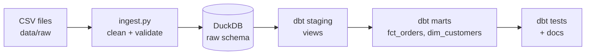
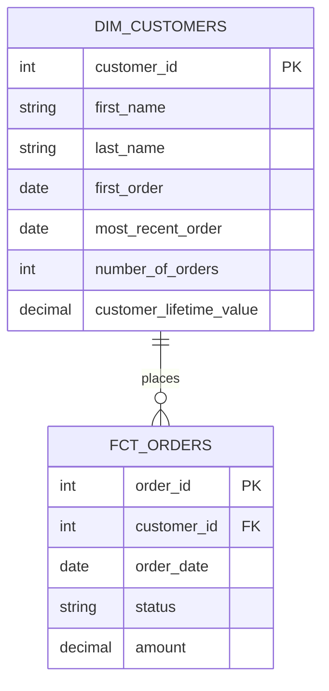

# Jaffle Pipeline: dbt + DuckDB ELT Project

A beginner-friendly, end-to-end data engineering project that runs entirely on your laptop.

A Python script loads raw e-commerce CSV files into **DuckDB**, validating them on the way in. **dbt** then transforms the raw data into clean, tested, documented analytics tables.

---

## Table of contents

1. [Project overview](#project-overview)
2. [Architecture](#architecture)
3. [Tech stack](#tech-stack)
4. [Data](#data)
5. [Project structure](#project-structure)
6. [Data model](#data-model)
7. [Getting started (Windows)](#getting-started-windows)
8. [Running the pipeline](#running-the-pipeline)
9. [Data quality and testing](#data-quality-and-testing)
10. [Viewing the documentation](#viewing-the-documentation)
11. [Example queries](#example-queries)
12. [Design decisions](#design-decisions)
13. [Troubleshooting](#troubleshooting)
14. [Roadmap](#roadmap)
16. [Acknowledgements](#acknowledgements)

---

## Project overview

**Goal:** build a small but realistic ELT (Extract, Load, Transform) pipeline that demonstrates core data engineering practices:

- Ingesting raw files into a database
- Validating data at the point of ingestion
- Layering data (raw, staging, marts)
- Modeling data as a star schema (fact and dimension tables)
- Testing and documenting transformations
- Making the whole pipeline reproducible with a single command

**Business scenario:** *Jaffle Shop* is a fictional e-commerce store. The pipeline answers questions such as:

- How much has each customer spent in total?
- When did each customer first and most recently order?
- What is the revenue and status breakdown of orders?

---

## Architecture



| Layer | Location | Purpose | Materialization |
|---|---|---|---|
| **Raw** | DuckDB `raw` schema | Data exactly as received, plus a load timestamp | Table (created by Python) |
| **Staging** | `models/staging` | Rename columns, fix units, no joins | View |
| **Marts** | `models/marts` | Business-ready fact and dimension tables | Table |

Keeping the layers separate means a transformation mistake never corrupts the original data, and each layer has one clear job.

---

## Tech stack

| Tool | Role |
|---|---|
| **Python 3.10+** | Ingestion script and validation |
| **DuckDB** | Embedded analytics database (a single file, no server needed) |
| **dbt (dbt-duckdb)** | SQL transformations, tests, and documentation |
| **SQL** | Transformation logic |
| **Git / GitHub** | Version control |

Developed and tested on Windows 11 with PowerShell, Python 3.14, and dbt-duckdb adapter 1.11.

---

## Data

The sample data comes from the open-source [dbt-labs/jaffle_shop_duckdb](https://github.com/dbt-labs/jaffle_shop_duckdb) project. It is fake data for a fictional store, with three CSV files:

| File | Columns |
|---|---|
| `raw_customers.csv` | `id`, `first_name`, `last_name` |
| `raw_orders.csv` | `id`, `user_id`, `order_date`, `status` |
| `raw_payments.csv` | `id`, `order_id`, `payment_method`, `amount` (in **cents**) |

Order `status` values: `placed`, `shipped`, `completed`, `return_pending`, `returned`.

---

## Project structure

```
jaffle_pipeline/
├── data/
│   └── raw/                      # Source CSV files
├── docs/
│   └── lineage.png               # dbt lineage graph screenshot
├── ingest/
│   └── ingest.py                 # Extract + load + validate
├── models/
│   ├── staging/
│   │   ├── sources.yml           # Declares the raw tables as dbt sources
│   │   ├── stg_customers.sql
│   │   ├── stg_orders.sql
│   │   └── stg_payments.sql
│   └── marts/
│       ├── fct_orders.sql        # Fact table: one row per order
│       ├── dim_customers.sql     # Dimension table: one row per customer
│       └── marts.yml             # Descriptions + tests
├── tests/
│   └── assert_no_negative_amounts.sql   # Custom data test
├── dbt_project.yml               # dbt project configuration
├── profiles.yml                  # dbt connection to DuckDB
├── requirements.txt              # Python dependencies
├── run.ps1                       # One-command pipeline runner
└── README.md
```

---

## Data model



### `fct_orders` (fact table)

One row per order.

| Column | Description |
|---|---|
| `order_id` | Unique order identifier |
| `customer_id` | The customer who placed the order |
| `order_date` | Date the order was placed |
| `status` | Current order status |
| `amount` | Total amount paid for the order, in dollars (0 if no payments) |

### `dim_customers` (dimension table)

One row per customer.

| Column | Description |
|---|---|
| `customer_id` | Unique customer identifier |
| `first_name`, `last_name` | Customer name |
| `first_order` | Date of the customer's first order |
| `most_recent_order` | Date of the customer's latest order |
| `number_of_orders` | Total orders placed (0 if none) |
| `customer_lifetime_value` | Total amount spent across all orders, in dollars (0 if none) |

---

## Getting started (Windows)

### Prerequisites

- **Python 3.10 or newer** (during installation, tick *Add python.exe to PATH*)
- **Git for Windows**
- A terminal such as PowerShell or VS Code's integrated terminal

Verify:

```powershell
py --version
git --version
```

### Installation

```powershell
# 1. Clone the repository
git clone https://github.com/newbie-1010/jaffle-pipeline-dbt-duckdb.git
cd jaffle-pipeline-dbt-duckdb

# 2. Create a virtual environment
py -m venv .venv

# 3. Allow PowerShell to run the activation script (one time only)
Set-ExecutionPolicy -Scope CurrentUser RemoteSigned

# 4. Activate the environment
.\.venv\Scripts\Activate.ps1

# 5. Install dependencies
pip install -r requirements.txt
```

If you prefer not to change the execution policy, use Command Prompt and run `.venv\Scripts\activate.bat` instead.

### Verify the setup

```powershell
dbt debug
```

You should see **All checks passed!**.

---

## Running the pipeline

Run all commands from the **project root** (the folder containing `dbt_project.yml`).

### One command

```powershell
.\run.ps1
```

### Step by step

```powershell
# 1. Extract and load: CSV files to the DuckDB raw schema (with validation)
python ingest\ingest.py

# 2. Transform and test: builds staging views, mart tables, and runs all tests
dbt build

# 3. Generate documentation
dbt docs generate
```

`dbt build` runs models and their tests in dependency order. If a test fails, the models downstream of it are skipped, so bad data does not spread.

To build only part of the project:

```powershell
dbt build --select staging     # staging layer only
dbt build --select marts       # marts only
dbt test                       # run tests only
```

---

## Data quality and testing

Quality checks run at two points.

### 1. At ingestion (Python)

`ingest.py` raises an error and stops the pipeline if:

- A loaded table is empty
- A table contains duplicate `id` values

It also removes exact duplicate rows and stamps every row with a `_loaded_at` timestamp for auditing.

### 2. During transformation (dbt)

| Test | Applied to | What it guarantees |
|---|---|---|
| `unique` | Source IDs, `order_id`, `customer_id` | No duplicate records |
| `not_null` | Source IDs, key columns | No missing keys |
| `relationships` | `fct_orders.customer_id` to `dim_customers.customer_id` | Every order belongs to a known customer |
| `accepted_values` | `fct_orders.status` | Status only holds expected values |
| Custom test | `assert_no_negative_amounts.sql` | No order has a negative amount |

Ingestion and transformation both check the data on purpose. In real teams they are often owned separately, so each side guards itself.

---

## Viewing the documentation

```powershell
dbt docs generate
dbt docs serve
```

Open `http://localhost:8080` in your browser. You will see:

- A description of every model and column
- The tests attached to each column

Press `Ctrl+C` in the terminal to stop the server.

---

## Example queries

Query the finished warehouse from Python:

```powershell
python -c "import duckdb; print(duckdb.connect('warehouse.duckdb').sql('select * from dim_customers order by customer_lifetime_value desc limit 5'))"
```

Useful SQL (run through DuckDB):

```sql
-- Top 10 customers by lifetime value
select customer_id, first_name, last_name, customer_lifetime_value
from dim_customers
order by customer_lifetime_value desc
limit 10;

-- Revenue and order count by status
select status, count(*) as orders, sum(amount) as revenue
from fct_orders
group by status
order by revenue desc;

-- Monthly revenue
select date_trunc('month', order_date) as month, sum(amount) as revenue
from fct_orders
group by 1
order by 1;

-- Customers who have never ordered
select customer_id, first_name, last_name
from dim_customers
where number_of_orders = 0;
```

---

## Design decisions

**Sources instead of seeds.** dbt *seeds* are small CSVs that dbt loads itself, which suits lookup lists. Raw operational data is better treated as a *source*, a table that already exists because another process loaded it. Here, Python plays the role of that upstream loader, which mirrors real pipelines.

**ELT instead of ETL.** Raw data is loaded first and transformed inside the database with SQL. This keeps the original data intact and makes transformations easy to re-run.

**Idempotent ingestion.** `CREATE OR REPLACE TABLE` means the script can be re-run any number of times and produces the same result.

**Views for staging, tables for marts.** Staging models are light and cheap, so views suffice. Marts are what people query, so they are stored as tables for fast reads.

**Local-first.** DuckDB is a single-file embedded database, so the whole project runs with no cloud account, server, or cost.

---

## Troubleshooting

| Problem | Cause | Fix |
|---|---|---|
| `running scripts is disabled on this system` | PowerShell execution policy | Run `Set-ExecutionPolicy -Scope CurrentUser RemoteSigned`, or use Command Prompt |
| `'utf-8' codec can't decode byte 0xff` | A config file was saved as UTF-16 | Re-save the file as UTF-8 (in VS Code: *Save with Encoding*, then *UTF-8*) |
| `dbt` is not recognized | Virtual environment not active | Run `.\.venv\Scripts\Activate.ps1` |
| `database is locked` | Another program has `warehouse.duckdb` open | Close any DB viewer or other terminal using it |
| `dbt debug` cannot find the profile | Wrong working directory | Run from the project root |
| Source table not found in dbt | Ingestion has not run | Run `python ingest\ingest.py` first |
| Column not found in staging models | CSV headers differ from expectations | Update the column names in `stg_*.sql` |
| A dbt test fails | Data broke a rule | Run `dbt test` and read the failing test name |

---

## Roadmap

- [ ] Export mart tables to **Parquet** using DuckDB's `COPY ... TO`
- [ ] Make ingestion **incremental** (load only new files or rows)
- [ ] Add `dbt source freshness` checks
- [ ] Add a **GitHub Actions** workflow that runs `dbt build` on every push
- [ ] Build a dashboard on `dim_customers` with Metabase or Streamlit
- [ ] Orchestrate the pipeline with Apache Airflow

---

## Acknowledgements

- Sample data and project inspiration: [dbt-labs/jaffle_shop_duckdb](https://github.com/dbt-labs/jaffle_shop_duckdb)
- [dbt](https://www.getdbt.com/) and [DuckDB](https://duckdb.org/)
